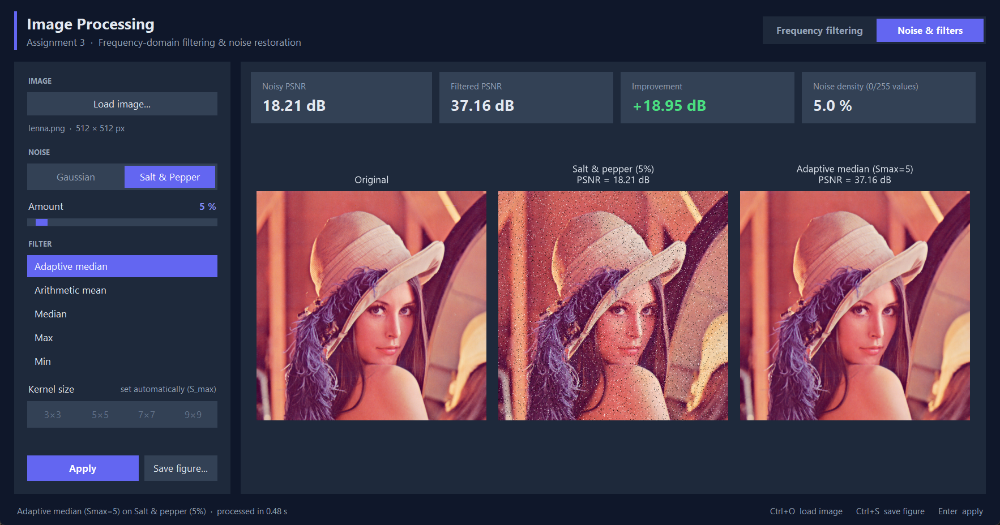
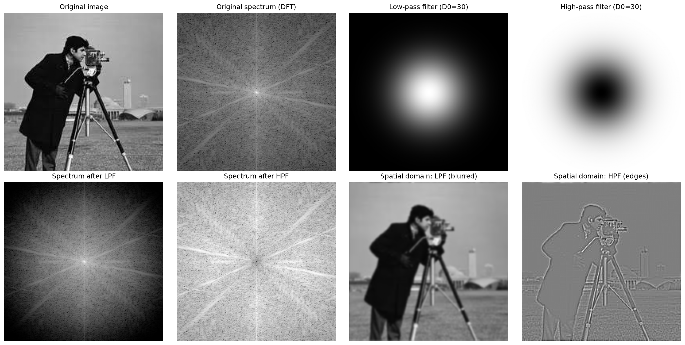
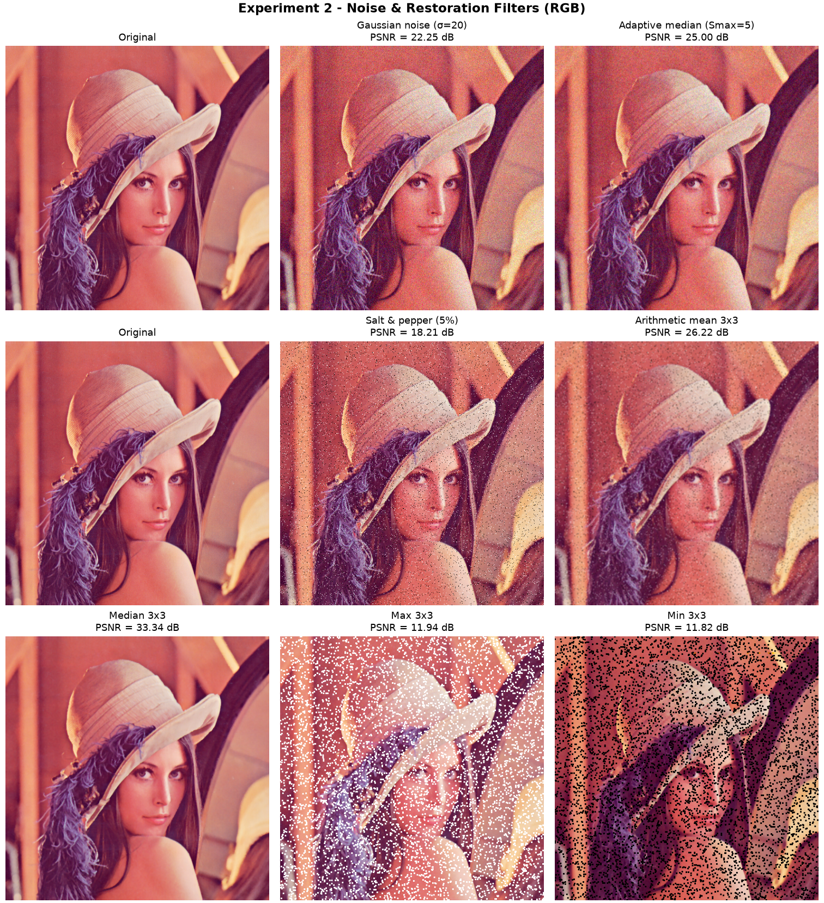
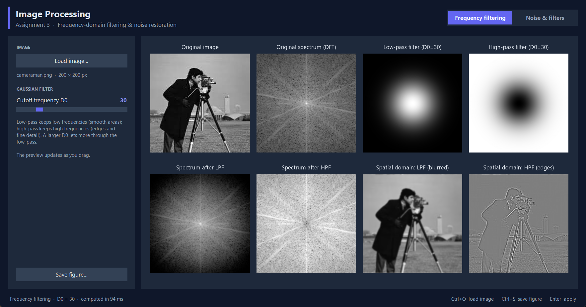

# Image Processing – Assignment 3

Two image-processing experiments in Python, each available as a standalone script and as a page in a Tkinter GUI:

1. **Frequency-domain filtering**: Gaussian low-pass and high-pass filters applied via the 2D DFT.
2. **Noise & restoration filters**: Gaussian and salt-and-pepper noise, removed with an adaptive median filter and classic spatial filters, compared by PSNR.

Both experiments work on full **RGB** images by processing each color channel separately.



## Getting started

Requires **Python 3.10+** with Tkinter (included in the standard Windows/macOS installers).

```bash
git clone https://github.com/Malak-Alaabiad/image-processing-assignment-3.git
cd image-processing-assignment-3

python -m venv .venv
# Windows
.venv\Scripts\activate
# macOS / Linux
source .venv/bin/activate

pip install numpy matplotlib pillow opencv-python numba
```

### Run

| Command | What it does |
|---|---|
| `python gui.py` | Opens the interactive GUI with one tab per experiment |
| `python experiment-1.py` | Runs Experiment 1 and saves `outputs/exp1_results.png` |
| `python experiment-2.py` | Runs Experiment 2, prints a PSNR summary and saves `outputs/exp2_results.png` |

> The first run of Experiment 2 takes a few extra seconds while Numba compiles the adaptive median filter. Later runs use the cache.

## Experiment 1: Frequency-domain filtering

`experiment-1.py` processes `images/cameraman.png`:

1. Computes the 2D DFT of each RGB channel and shifts the zero frequency to the center.
2. Builds a **Gaussian low-pass filter** `H(u,v) = exp(-D²(u,v) / 2D0²)` with cutoff `D0 = 30`, and the matching **high-pass filter** `1 − H`.
3. Multiplies the spectrum by each filter.
4. Applies the inverse DFT to return to the spatial domain.
5. Plots the results in a 2×4 grid.



The low-pass result is a smooth, blurred image. The high-pass result keeps only edges and fine detail.

## Experiment 2: Noise & restoration filters

`experiment-2.py` processes `images/lenna.png` in two parts.

**Part A: Gaussian noise + adaptive median filter**
- Adds Gaussian noise (mean 0, σ = 20) to each channel.
- Restores the image with an **adaptive median filter**: the window grows from 3×3 up to `S_max` until the median is not an extreme value, and only pixels that are themselves extremes get replaced.
- Picks `S_max` automatically from the estimated noise density (the share of pure 0/255 values):

  | Noise density | < 20% | < 40% | < 60% | ≥ 60% |
  |---|---|---|---|---|
  | `S_max` | 5 | 7 | 9 | 11 |

- Compiles the per-pixel loop with **Numba** (`@njit`) for speed.

**Part B: Salt & pepper noise + classic filters**
- Adds 5% salt-and-pepper noise.
- Compares 3×3 **arithmetic mean**, **median**, **max** (dilation) and **min** (erosion) filters.

### Results (PSNR vs. original, higher is better)

| Image | PSNR |
|---|---:|
| Gaussian noise (σ = 20) | 22.25 dB |
| → Adaptive median (S_max = 5) | 25.00 dB |
| Salt & pepper (5%) | 18.21 dB |
| → Arithmetic mean 3×3 | 26.22 dB |
| → **Median 3×3** | **33.34 dB** |
| → Max 3×3 | 11.94 dB |
| → Min 3×3 | 11.82 dB |

- **Median** is the clear winner for salt and pepper. Outliers never become the median, so they are removed without blurring edges.
- **Mean** reduces the noise but smears each outlier into its neighbors.
- **Max** and **min** make things *worse*. Max spreads every white (salt) pixel and min spreads every black (pepper) pixel, so each one only suits a single noise polarity.
- **Adaptive median** gives a moderate gain on Gaussian noise. It is designed for impulse noise, and Gaussian noise rarely produces the pure 0/255 values it targets.



## GUI

`gui.py` puts both experiments in one dark-themed window. Switch between them with the buttons in the top-right corner.

| Page | Controls | Output |
|---|---|---|
| **Frequency filtering** | Load image, cutoff `D0` slider (1–150) | The full 2×4 grid, redrawn live as you drag the slider |
| **Noise & filters** | Load image, noise type and strength (Gaussian σ 1–100 or salt & pepper amount 1–90%), filter, kernel size (3×3 to 9×9), **Apply** | Original, noisy and filtered images, plus tiles for noisy PSNR, filtered PSNR, improvement and noise density |

- Choosing a filter also picks a matching noise type: salt & pepper for the adaptive median, Gaussian for the others. You can change it before pressing **Apply**.
- Kernel size is disabled for the adaptive median, which picks its own window size.
- **Save figure…** saves the current view as an image, by default into `outputs/`.
- Shortcuts: `Ctrl+O` load image, `Ctrl+S` save figure, `Enter` apply.
- No extra packages are needed. The theme is built with Tkinter's own `ttk` styles.



## Project structure

```
.
├── gui.py                  # Tkinter GUI (both experiments)
├── experiment-1.py         # Frequency-domain filtering script
├── experiment-2.py         # Noise & restoration filters script
├── images/
│   ├── cameraman.png       # Input image for Experiment 1
│   └── lenna.png           # Input image for Experiment 2
├── outputs/
│   ├── exp1_results.png    # Output of Experiment 1
│   └── exp2_results.png    # Output of Experiment 2
└── docs/
    ├── gui-frequency.png   # GUI screenshots for this README
    └── gui-noise.png
```
